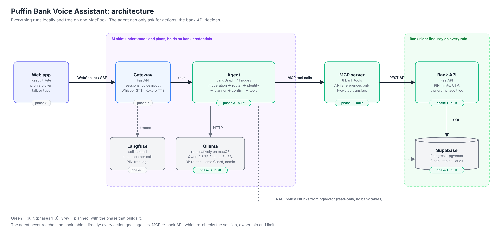
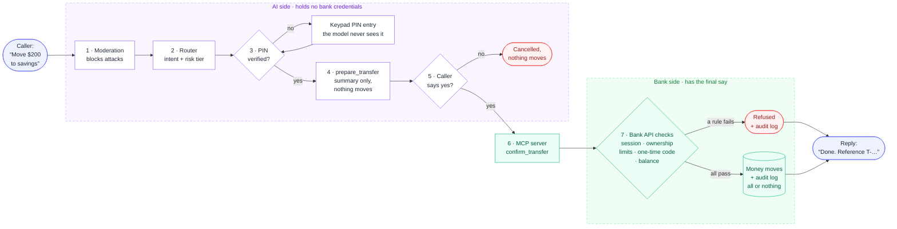
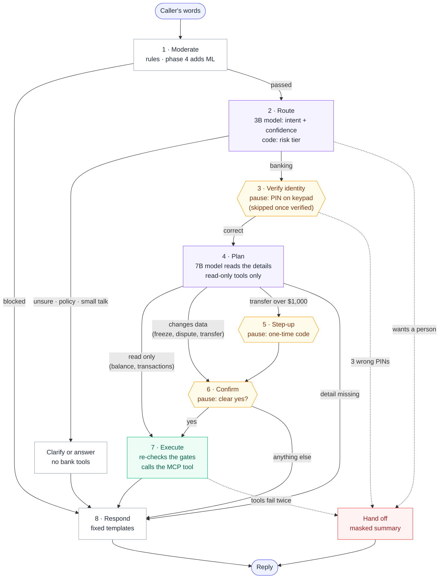

# Puffin Bank Voice Assistant

A voice banking assistant for a fictional bank, built with **LangGraph, FastAPI, MCP, Supabase and local Ollama models**. It's 100% free and runs on one MacBook.

> **The model chooses words, not permissions.** The agent can only *ask* for an action. The bank API re-checks every rule and has the final say.

**Status:** phases 1–3 of 8 done (bank API, MCP server, LangGraph agent). [Roadmap](#roadmap)

## Architecture



| Component | Role | Tech | Status |
| --- | --- | --- | --- |
| Web app | Pick a demo customer, talk or type | React + Vite | Phase 8 |
| Gateway | Sessions, speech in/out | FastAPI, Whisper, Kokoro | Phase 7 |
| Agent | Moderation → routing → identity → confirm → tools | LangGraph | ✅ Built (ML moderation, RAG next) |
| MCP server | Bank actions as tools, masked results | MCP Python SDK | ✅ Built |
| Bank API | Final say: PIN, limits, ownership, audit | FastAPI | ✅ Built |
| Database | Bank data + policy vectors | Supabase (Postgres, pgvector) | ✅ Built |
| Models | Router 3B, agent 7B (safety, embeddings later) | Ollama | ✅ Built |
| Tracing | One trace per call, secrets redacted | Langfuse | Phase 6 |

## How a request flows



## Quick start

Needs Docker Desktop, [Supabase CLI](https://supabase.com/docs/guides/cli), [uv](https://docs.astral.sh/uv/).

```bash
make setup    # .env + Python packages
make db       # local Supabase (first start creates the tables)
make seed     # demo customers
make dev      # bank API  → http://127.0.0.1:8000/docs
make mcp      # MCP server → http://127.0.0.1:8100/mcp   (second terminal)
make models   # Ollama models for the agent (once)
make chat     # talk to the agent                       (third terminal)
make test     # all tests
```

`make up` runs everything in Docker. `make` alone lists every command.

| Demo customer | Code | PIN | Story |
| --- | --- | --- | --- |
| Priya Sharma | C-1001 | 2468 | Healthy balances |
| Marcus Lee | C-1002 | 1357 | Lost card → freeze |
| Elena Rossi | C-1003 | 8642 | Suspicious charge → dispute |
| Sam Okafor | C-1004 | 9753 | Low balance → hits limits |
| Impostor | – | – | Tries injection and impersonation |

## What the bank enforces

| Rule | How |
| --- | --- |
| 3 wrong PINs → locked | One atomic `UPDATE`; parallel guesses can't slip through |
| 10 idle minutes → session expires | Checked on every request |
| Only your own data | Customer comes from the session; ownership in the SQL `WHERE` |
| Other people's IDs look nonexistent | `404`, never `403` |
| Freeze instantly, unfreeze human-only | No unfreeze code exists |
| Disputes: ≤ 60 days, posted, one per purchase | Unique column + `ON CONFLICT DO NOTHING` |
| Transfers: own accounts, ≤ $2,500, ≤ $5,000/day, ≥ $0 | Checked before money moves; DB rejects negative balances |
| Over $1,000 → one-time code | 6 digits, hashed, 5 min, 3 tries |
| Retries never pay twice | `Idempotency-Key` |
| No race conditions | Customer row locked per transfer |
| Crash mid-transfer → nothing moves | One DB transaction per request |
| Secrets never leak | bcrypt hashes; never logged or echoed |
| Everything audited | `audit_log` row per action, allowed or denied |

All limits live in [`config.py`](services/bank_api/app/core/config.py).

## The agent

The LLM only **classifies the intent** and **reads details** ("savings", "$200"). Code decides everything else.



| Safeguard | How |
| --- | --- |
| PIN and codes never reach a model | The graph pauses (`interrupt`); the gateway sends them straight to the bank |
| Nothing changes without a clear yes | Only "yes", "go ahead"… count; "yes, and also…" cancels |
| Planner can't change anything | It gets a read-only toolbox; writes run only in Execute |
| Gates checked twice | Routing, then again inside Execute |
| No stale yes | Pending actions are cleared at the end of every turn |
| Injection, card numbers, PINs in text | Blocked before any model; history keeps `[withheld]` |
| Facts aren't paraphrased | Replies come from fixed templates |
| Unsure or stuck | Clarify twice, then hand off with a masked summary |

## MCP tools

| Tool | Does | Writes? |
| --- | --- | --- |
| `get_accounts` | Accounts → refs `A1`, `A2`… | – |
| `list_transactions` | Activity → refs `T1`, `T2`… | – |
| `list_cards` | Cards → refs `C1`… | – |
| `list_disputes` | Disputes and status | – |
| `freeze_card` | Freeze (idempotent) | ✏️ |
| `open_dispute` | Dispute, or return the open one | ✏️ |
| `prepare_transfer` | Step 1: summary, moves nothing | – |
| `confirm_transfer` | Step 2: moves money, once | 💸 |

- **No real IDs, tokens or PINs** reach the model: only short per-conversation refs.
- **No database access:** HTTP to the bank API only, [enforced by a test](services/mcp_server/tests/unit/test_no_database_access.py).
- **Try it:** `make mcp-token` → `make mcp-inspect` → Streamable HTTP, `http://127.0.0.1:8100/mcp`, header `Authorization: Bearer <token>`.

## Tests

| Suite | Covers | Command |
| --- | --- | --- |
| Bank unit | Every rule at its exact edges, fake repositories | `make test-unit` |
| Bank integration | Real HTTP + DB: sad paths, races, mid-transfer crash | `make test` |
| MCP unit | Tools, refs, masking, two-step transfer, MCP protocol | `make test-unit` |
| MCP live | MCP → bank API → DB, end to end | `make test` (with `make dev`) |
| Agent unit | Routing table, every gate combination, each node, whole conversations | `make test-unit` |
| Agent live | Real Ollama models → MCP → bank | `make test` (all services up) |

## Project layout

```text
services/
├── bank_api/     route → service → repository → database
├── mcp_server/   server.py (MCP) → tools.py (logic) → bank_client.py (HTTP)
├── agent/        graph.py (LangGraph) → nodes/ (one per step) → routing.py (rules)
supabase/migrations/   schema, one file per change
data/seed/             demo customers
docs/diagrams/         architecture + flows
```

## Roadmap

| # | Phase | Status |
| --- | --- | --- |
| 1 | Bank API, database, tests | ✅ |
| 2 | MCP server | ✅ |
| 3 | LangGraph text agent: router, identity gate, confirmation, tools | ✅ |
| 4 | Moderation: rules → scikit-learn → Llama Guard | 🔨 Next |
| 5 | RAG over policies, grounding check | |
| 6 | Evals + tracing: Ragas, red team, model benchmark | |
| 7 | Voice: Whisper, Kokoro, streaming | |
| 8 | Web app, decision records, demo video | |
